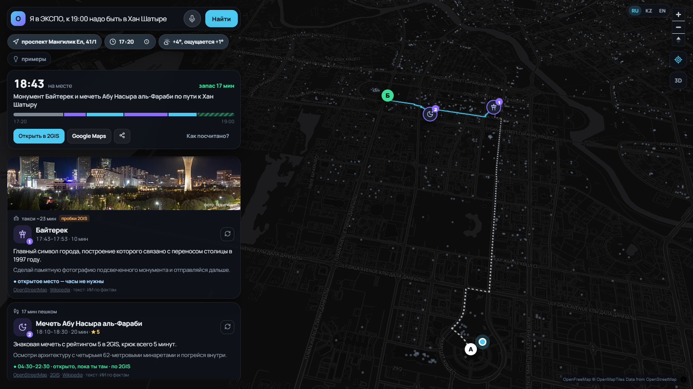
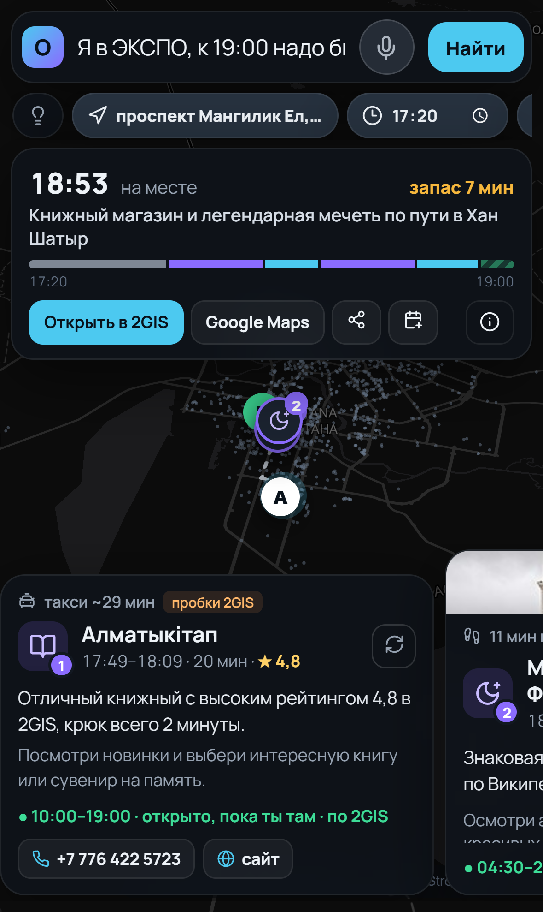
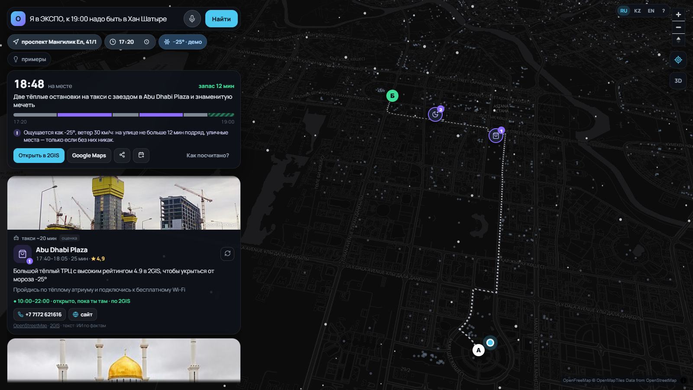
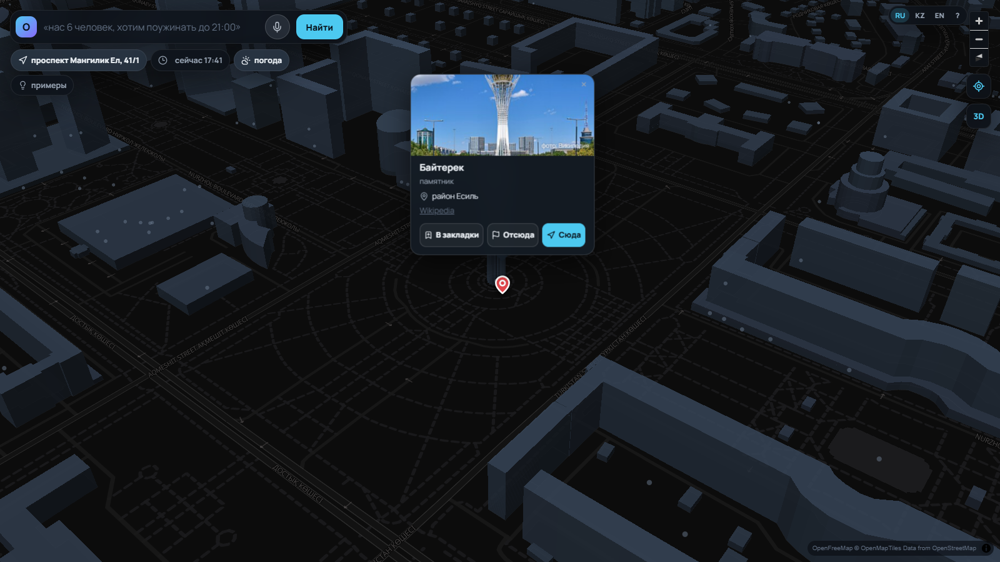

# Окно — помощник по свободному времени в Астане

Build with AI Hackathon (AITU × GDG Astana), трек **AI for Smart City**, кейс НИЦ Smart City «ИИ-помощник по прогулкам».

> «Я в ЭКСПО, к 19:00 надо быть в Хан Шатыре» → 1–3 места по пути, которые ты **точно успеешь**:
> реальное время пешком по улицам, часы работы **на момент прихода**, погода и ветер, пробки для такси.
> Только реальные места — ничего не выдумано; где данных нет, так и пишем.

**Проверено цифрами:** оценка по критериям кейса — **113/120 ответов без единой выдумки**, средние 4.7 / 4.5 / 4.7 / 4.7 из 5 ([docs/evaluation.md](docs/evaluation.md)) · 120/120 синтетических запросов «как пишут люди» (15 типов, 3 языка) · 44/44 автопроверок в 13 тестовых сценариях · 100 случайных запросов — 0 опозданий и 0 закрытых мест · на 30 одинаковых запросах у Claude без данных 5 ответов с ошибками, у **того же Gemini без наших данных** — 4, у «Окна» (Gemini + RAG) — 0 · 43 автотеста в GitHub Actions.

<p align="center">
  
  
</p>
<p align="center">
  
  
</p>

## Материалы для жюри
- **Сайт (работает онлайн):** https://okno-astana.onrender.com — бесплатный хостинг «засыпает» без посетителей, первое открытие ~30–50 с
- **Презентация:** [docs/Okno_presentation.pdf](docs/Okno_presentation.pdf) (текст выступления — [docs/pitch.md](docs/pitch.md))
- **Тестовые сценарии, ограничения, этика:** [docs/Okno_scenarios.pdf](docs/Okno_scenarios.pdf) · [docs/scenarios.md](docs/scenarios.md) — 44/44 автопроверок
- **Датасет мест (собран автоматически):** [docs/dataset.md](docs/dataset.md) — 1304 места Астаны, все поля из ТЗ
  (описание, категория/теги, часы с источником, контакты, популярность) + «что делать», район, станция LRT ·
  таблица [data/dataset/astana_poi.csv](data/dataset/astana_poi.csv) (открывается в Excel)
- **Оценка качества по критериям жюри:** [docs/evaluation.md](docs/evaluation.md) — судья-ИИ сверяет каждое «почему» с данными места (ищет выдумки) и ставит 1–5 за релевантность, учёт контекста, «почему», «что делать»; было → стало после исправлений
- **120 синтетических проверочных запросов:** [docs/synthetic_tests.md](docs/synthetic_tests.md) — 15 типов (5 сценариев из ТЗ,
  группы, коляска, мороз, ночь, 3 языка, невыполнимые) с ожидаемым ответом и автопроверкой · вход —
  [data/dataset/synthetic_queries.jsonl](data/dataset/synthetic_queries.jsonl), повторить — `scripts/synthetic.py`
- **Сравнение с обычным ИИ-чатботом:** [docs/benchmark.md](docs/benchmark.md) — 30 одинаковых запросов, одна проверка
- **Демо-видео:** https://youtu.be/v6skg5M2-OQ (запись — скриптом `scripts/record_demo.py`)

## Как проверить за 2 минуты
1. Открыть сайт → разрешить геопозицию (или нажать на карту). Нажать **💡 примеры** → «ЭКСПО → Хан Шатыр к 19:00».
2. Посмотреть карточки: **почему**, **что делать**, часы **на момент прихода**, источник; нажать **«Как посчитано?»** — цепочка RAG и «почему не другие места».
3. Нажать на плашку погоды → **−25° · демо**: маршрут перестроится через тёплые места.
4. Написать по-казахски: «Хан Шатырдың жанындамын, бір сағат бар, кофе ішкім келеді» — всё переключится на казахский.
5. Нажать на любое здание на карте → карточка «что здесь» → **В закладки / Отсюда / Сюда**.
6. Невыполнимое: «Я в ЭКСПО, через 30 минут надо быть на вокзале Астана-1» — честный отказ с советом.
7. Открыть **/city** — обезличенный спрос для города.

## Что умеет
- **Окно A → Б или «есть час, потом обратно»** — 1–3 места по пути, запас до срока, полоса времени, маршрут на 3D-карте.
- **Часы работы на момент прихода и ухода** (OSM + 2GIS); нет данных — пометка «оценка».
- **Погода на часы маршрута** (почасовой прогноз Open-Meteo) и воздух: мороз и ветер ограничивают время на улице, ночью — без парков,
  при смоге — больше крытых мест; предупреждения про **туман и гололёд**. Демо зимы: нажать на плашку погоды → «−25° · демо».
- **Пробки для такси** — 2GIS (живые или типичные для этого часа), иначе своя оценка часа пик.
- **LRT Астаны** (линия Әуежай — Нұрлы Жол, открыта 16.05.2026): 18 станций из OpenStreetMap; для длинного отрезка на такси —
  подсказка «можно на LRT от станции X до Y, ~N мин» (время — оценка, расписания в открытых данных нет), если запас по времени позволяет.
- **Сам ослабляет условия, а не отказывает:** нет места с розеткой — кофе рядом; пешком не дойти — такси; мало времени поесть — «быстро перекусить», и честно пишет, что изменил.
- **Карточка «что это и как пользоваться»** при первом открытии (потом — кнопка «?»).
- **События:** «концерт в Барыс Арене в 20:00» → прийти за 25 мин; рейс → за 1,5 ч; поезд → за 20 мин.
- **Пожелания и люди:** кофе/поработать (2GIS: «можно с ноутбуком»), с ребёнком (детские центры), на коляске (медленнее темп, честно про пандусы), компания 5+ (места с заказом столиков), с собакой (только улица), «вид», «тихо», «необычное», «романтика», «национальная кухня», прямо названный тип места («хочу в музей»).
- **«Где я?» по фото (Gemini Vision):** кнопка-камера — сфотографируй ориентир или вывеску, и «Окно» поставит старт там, где ты стоишь. Удобно туристу, который не знает названий. Фото уменьшается в браузере и не сохраняется.
- **Линия LRT на карте:** 18 станций и сама линия из OpenStreetMap, названия станций на языке интерфейса.
- **Три языка:** русский, казахский, английский — интерфейс сам переключается на язык запроса.
- **Моё место определяется само** и показывается адресом (улица, дом); маршрут строится от него, если не написано «я у …».
- **Карта как в 2GIS:** нажал на здание → пин и карточка (что это, адрес, часы, рейтинг, фото, этажность) с кнопками
  «В закладки / Отсюда / Сюда». **Закладки** со значком (Дом, Работа, Учёба…) — здание подсвечивается цветом закладки.
- **Голосовой ввод** (микрофон рядом с «Найти»), **фото мест** из Википедии, значок **♿ доступности**, **телефон и сайт** из OpenStreetMap.
- **Афиша:** официальный сайт Astana Opera (обновляется каждый день) — событие показывается, только если целиком помещается в окно.
- **«↻ другое место»**, **«спланировать позже»** (если до срока ещё полдня), **поделиться ссылкой**, **план в календарь (.ics)**, **открыть в 2GIS / Google Maps**.
- **Спрос для города** (`/city`): обезличенные счётчики — что ищут и **чего не хватило** (закрыто в нужное время, далеко, нет часов в данных); без координат и текстов запросов — польза для акимата / Visit Astana.
- **«Как посчитано?»** — цепочка RAG с цифрами запроса, «почему не другие места» (сколько отсеяно: закрыто / не успеть / мороз)
  и список использованных данных.
- **Честнее чатбота — проверено:** `docs/benchmark.md` — 30 одинаковых запросов «Окну» и обычному ИИ-чатботу, одинаковая проверка
  (закрытые места, несуществующие места, физически невозможные переходы, опоздания).
- **Работает без ИИ:** если нет сети или ключей — разбор правилами и тексты из фактов (Википедия, рейтинг) на языке запроса.

## Как это работает (RAG)
1. **Понимание запроса** — Gemini 3.5 Flash превращает фразу (RU/KZ/EN) в структуру: откуда, куда, к скольки, пожелания, событие, язык.
2. **Поиск (Retrieval)** — алгоритм (не ИИ) отбирает места из базы (OpenStreetMap + Wikidata/Википедия + 2GIS) и перебирает сотни маршрутов:
   время пешком по улицам (OSRM / 2GIS), такси с пробками, часы работы на весь визит, погода, темнота, пожелания, запас до срока.
3. **Генерация** — Gemini пишет «почему» и «что делать» **только по фактам** из шага 2 (часы, рейтинг 2GIS, факт из Википедии, «крюк 3 мин»).
   Нет данных (розетки, пандус) — говорит, что нет данных.
4. **Прозрачность** — у каждого места источник (OSM / 2GIS / Википедия) и надёжность часов (проверено / оценка).

## Запуск
```bash
python -m venv .venv && .venv/Scripts/pip install -r requirements.txt   # Windows
cp .env.example .env    # ключи: GEMINI_API_KEY (Google AI Studio) и/или OPENROUTER_API_KEY; DGIS_KEY — необязательно
python -m uvicorn app.main:app --port 8010
# открыть http://localhost:8010
```
Ссылка сразу на сценарий: `http://localhost:8010/?q=Я у Байтерека, вылет в 18:30&t=15:00&w=cold`
Без ключей всё тоже работает (правила + шаблоны, без пробок 2GIS).

## Структура
- `scripts/collect_osm.py` — автоматический сбор мест из OpenStreetMap → `data/poi.json`;
  `scripts/collect_wiki.py` — известные места и описания из Wikidata/Википедии → `data/wiki.json`.
  **GitHub Actions** (`.github/workflows/update-poi.yml`) обновляет обе базы каждый понедельник.
  `scripts/collect_events.py` — афиша Astana Opera → `data/events.json` (GitHub Actions `update-events.yml` — каждый день).
- `scripts/collect_2gis.py` — популярные места из 2GIS по своему ключу (локально, в репозиторий не публикуется).
- `app/events.py` — афиша в окне · `app/citystats.py` — спрос для города (только счётчики) · `app/planner.py` — планировщик · `app/hours.py` — часы работы · `app/geo.py` — маршруты, погода, воздух, геокодер ·
  `app/dgis.py` — 2GIS (места, пробки, лимиты) · `app/llm.py` — Gemini · `app/main.py` — API.
- `static/index.html` — интерфейс (MapLibre + OpenFreeMap, иконки Lucide).
- Проверки: `scripts/stress.py` (инварианты «не опоздал» и «всё открыто»), `scripts/qa.py` (38 живых фраз), `scripts/benchmark.py` (сравнение с чатботом),
  `scripts/test_core.py` (43 проверки: ядро + API, запускаются в GitHub Actions), `scripts/record_demo.py` (демо-видео), `scripts/make_slides.py` (презентация),
  `scripts/ux_flow.py` (прогон интерфейса), `scripts/make_scenarios_doc.py` (документ со сценариями).

## Приватность и честность
- Точка пользователя округляется до ~150 м и нигде не сохраняется; запросы не логируются; аккаунтов нет.
- Адрес «где я» — по OpenStreetMap (Nominatim), без сохранения. Закладки и последняя точка — только в браузере (localStorage).
- Голосовой ввод распознаёт сам браузер (в Chrome — сервис Google); озвучки и записи голоса у нас нет.
- «Мои места» хранятся только в браузере пользователя; в ссылку «поделиться» геопозиция не попадает.
- Каждая рекомендация помечена: источник места, надёжность часов, текст от ИИ или шаблон.
- Защита от перерасхода: лимит запросов с одного адреса, дневные лимиты ИИ и 2GIS.

## Данные и лицензии
© участники OpenStreetMap (ODbL) · Wikidata (CC0) и Википедия (CC BY-SA) · 2GIS Places / Routing API (по ключу) ·
погода и качество воздуха Open-Meteo · маршруты OSRM (FOSSGIS) · карта OpenFreeMap · ИИ Gemini (Google AI Studio, запасной канал OpenRouter).
