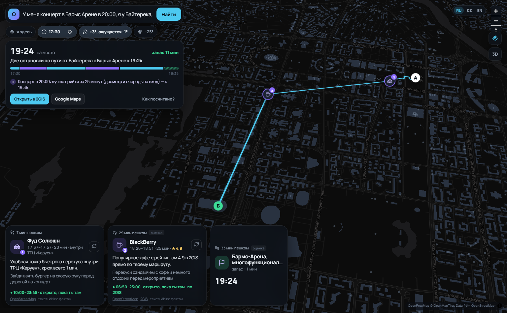
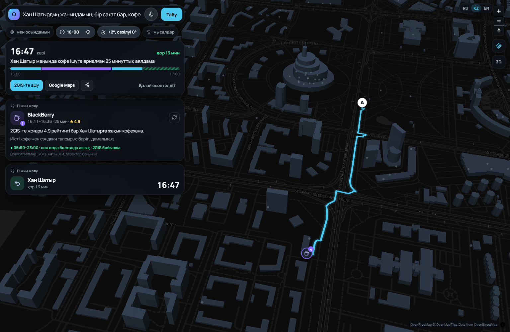

# Окно — тестовые сценарии, ограничения и этика

_Документ сгенерирован автоматически скриптом `scripts/make_scenarios_doc.py` 19.10.2026 16:50: каждый сценарий — реальный запрос к работающей системе, ответы ниже не редактировались._

**Итог автопроверок: 44 из 44 пройдено.** Стресс-тест: 100 запросов за 82 c: план 58, честный отказ 42, ошибок 0, нарушений 0

## 1. Что делает система

«Окно» — помощник по свободному времени в Астане. Человек пишет обычной фразой, где он, куда ему нужно и к скольки (или «есть час, потом обратно»). Система подбирает **1–3 реальных места по пути** так, чтобы человек точно успел: с реальным временем пешком, часами работы **на момент прихода**, погодой и ветром, пробками для такси.

**Что ещё умеет:**
- **Три языка** — русский, казахский, английский: интерфейс переключается сам на язык запроса, ответы ИИ и системные заметки — тоже.
- **События:** «концерт в Барыс Арене в 20:00» → маршрут к арене с запасом на досмотр (концерт 25 мин, матч 30, спектакль 20); рейс → в аэропорту за 1,5 ч; поезд → на вокзале за 20 мин.
- **Свои места:** «Дом», «Тётя Гуля» — сохраняются только в браузере пользователя; «к тёте Гуле к 9» понимается в любом падеже.
- **«Я здесь»** — геолокация с округлением до ~150 м; поиск адресов понимает сокращения («мну универ» → Maqsut Narikbayev University).
- **Погода и воздух:** мороз и ветер ограничивают время на улице; при плохом воздухе (AQI > 150) — больше крытых мест; снег/дождь видны на фоне.
- **«↻ другое место»** — заменить одну остановку, не трогая остальные; **3D-карта**; ссылки «Открыть в 2GIS / Google Maps».
- **Моё место определяется само** и показывается адресом (улица, дом); маршрут — от него, если человек не написал «я у …».
- **Карта как в 2GIS:** нажал на здание → пин и карточка «что здесь» (название из базы, адрес, часы, рейтинг, фото, контакты, этажность) и кнопки «В закладки / Отсюда / Сюда». **Закладки** со значком (Дом, Работа, Учёба…) подсвечивают здание.
- **Голосовой ввод**, **фото мест** (Википедия/Wikimedia Commons), **♿ доступность** и **телефон/сайт** из OpenStreetMap.
- **Погода на часы маршрута** (почасовой прогноз), предупреждения про **туман и гололёд**; демо зимы — нажатием на плашку погоды.
- **«Спланировать позже»** — если до срока полдня, предлагает сдвинуть маршрут ближе к делу (часы мест пересчитываются).
- **Афиша** с официального сайта Astana Opera (сбор каждый день): событие предлагается, только если целиком помещается в окно.
- **Спрос для города** (`/city`): обезличенные счётчики — что ищут люди и чего им не хватило (закрыто, далеко, нет данных); без координат и текстов запросов — основа для B2G-аналитики.

### Как работает RAG (высокоуровнево)

1. **Понимание запроса (LLM).** Gemini превращает фразу в структуру: откуда, куда, к скольки, пожелания, язык. Если ИИ недоступен — работает запасной разбор правилами.
2. **Поиск по базе (Retrieval).** Алгоритм — не ИИ — отбирает кандидатов из базы мест OpenStreetMap и перебирает сотни вариантов маршрута. Жёсткие проверки: реальное время пешком по улицам (OSRM), часы работы на весь визит, мороз (не больше N минут на улице подряд), темнота (без парков и площадок), пожелания, запас до срока.
3. **Генерация (LLM).** Gemini получает **только факты** о выбранных местах и пишет короткие «почему» и «что делать» на языке пользователя. Ему запрещено придумывать рейтинги, меню, события и обещать то, чего нет в данных.
4. **Прозрачность.** В интерфейсе видно, что система поняла, какие шаги сделала и за сколько, какие данные использованы; у каждого места — пометка надёжности часов и ссылка на источник.

## 2. Данные

- **Источник:** OpenStreetMap через Overpass API. **Сбор автоматизирован:** `scripts/collect_osm.py`, GitHub Actions пересобирает базу каждый понедельник.
- **Объём:** 1465 мест Астаны; часы работы есть у 559 (38%).
- **Категории:** кафе — 358, детская площадка — 335, ресторан — 190, бар — 133, фастфуд — 125, торговый центр — 54, памятник — 41, парк — 35, детский центр — 28, коворкинг — 26, галерея — 23, кино — 19, музей — 16, достопримечательность — 15.
- **Ориентиры:** справочник из 32 известных мест (ЭКСПО, Байтерек, аэропорт, вокзалы, арены, университеты…) для понимания фраз «я у …»; опечатки прощаются («байтерика»).
- **Фото мест:** главное изображение из Wikidata/Википедии (Wikimedia Commons, свободные лицензии) — у ~25 известных мест.
- **Контакты и доступность:** телефон, сайт, Instagram и отметка wheelchair из OpenStreetMap (у ~190 мест).
- **Wikidata + Википедия:** известные места Астаны (`scripts/collect_wiki.py`, обновляется тем же GitHub Actions): сигнал известности — на скольких языках есть статья (Байтерек — 29), и 1–2 предложения описания как факты для «почему» (ИИ пишет «по Википедии…», в карточке — ссылка). Добавляет места, которых нет в OSM: Дворец мира и согласия, Ак Орда, соборы. Тексты — CC BY-SA.
- **Популярные места 2GIS:** `scripts/collect_2gis.py` раз в сутки собирает места с рейтингом по 8 категориям и 5 районам (кофейни, бары, рестораны, музеи, галереи, детские игровые центры, кино, коворкинги) — ~190 мест, из них ~160 новых для базы; файл локальный, в репозиторий не публикуется (данные 2GIS — по ключу).
- **Уточнение по 2GIS (Places API):** для мест-кандидатов маршрута — свежие часы работы, рейтинг и отметки («Можно с ноутбуком», «Детский уголок», «Меню на английском»). Только для уже отобранных кандидатов (единицы запросов на маршрут), ответы кэшируются локально и не публикуются в репозитории; без ключа система работает на одном OSM. В интерфейсе помечено «2GIS».
- **Погода:** Open-Meteo — сейчас и **почасовой прогноз на окно маршрута** (худший час: «ощущается как», ветер, осадки, туман), закат; без ключа.
- **Адрес «где я»:** OpenStreetMap Nominatim (обратное геокодирование), без сохранения.
- **Маршруты:** OSRM (серверы FOSSGIS) — реальный путь по улицам пешком и на машине; запасной вариант — 2GIS Routing API.
- **Пробки:** 2GIS Routing API — живые (если время «сейчас») или типичные для этого часа и дня недели; без ключа — своя оценка часа пик.
- **Качество воздуха:** Open-Meteo Air Quality (US AQI), без ключа.
- **ИИ:** Gemini 3.5 Flash (Google AI Studio) — понимание запроса и тексты; запасной канал — OpenRouter; без ИИ — правила и шаблоны.
- **Чего в данных нет:** очередей, временных закрытий, расписания автобусов/LRT, афиши событий (открытого API у афиш Астаны нет), информации о розетках и тишине. Система об этом говорит, а не придумывает.

## 3. Тестовые сценарии

| № | Сценарий | Откуда в кейсе | Автопроверки | Время ответа |
|---|---|---|---|---|
| S1 | Деловой гость между встречами | свой (главный сценарий «Окна») | ✅ 5/5 | 1.0 с |
| S2 | То же в мороз −25° (симуляция) | учёт погоды | ✅ 4/4 | 4.0 с |
| S3 | «Я возле Mega Silk Way, хочу прогуляться 30–60 минут» | сценарий из кейса | ✅ 4/4 | 7.1 с |
| S4 | «Тихое место с кофе и розеткой» | сценарий из кейса | ✅ 4/4 | 6.6 с |
| S5 | «Еду с ребёнком» | сценарий из кейса | ✅ 4/4 | 11.1 с |
| S6 | «Я турист, 2 часа перед вылетом» | сценарий из кейса + мультиязычность | ✅ 5/5 | 7.8 с |
| S7 | «Необычная ночная активность» | сценарий из кейса | ✅ 3/3 | 7.3 с |
| S8 | Невыполнимое окно | сомнительный запрос | ✅ 1/1 | 3.9 с |
| S9 | Событие: концерт вечером | события (креативность) | ✅ 4/4 | 6.3 с |
| S10 | Запрос на казахском | мультиязычность | ✅ 3/3 | 6.8 с |
| S11 | Пример из ТЗ дословно: «Я у здания Экспо 2017, хочу что-то необычное на 1–2 часа, пешком» | пример ожидаемого вывода из кейса | ✅ 4/4 | 6.7 с |
| S12 | «Хочу в музей» в 7 утра | закрытые места / неполные данные | ✅ 3/3 | 11.3 с |

### S1. Деловой гость между встречами

- **Вход:** «Я в ЭКСПО, к 19:00 надо быть в Хан Шатыре» · время старта 17:20 · погода: реальная
- **Ожидаемый тип ответа:** Маршрут А→Б с 1–3 остановками, прибытие до 19:00 с запасом; если пешком не успеть — часть пути на такси с пометкой «оценка».
- **Как система поняла:** откуда — ЭКСПО, куда — Хан Шатыр, к — 19:00, окно — 100 мин, пожелания — нет, язык — ru
- **Ответ:** «Книжный Алматыкітап и знаковая мечеть с крюком 5 минут по пути в Хан Шатыр». Прибытие **18:53** (окно 17:20–19:00), запас 7 мин, на улице 26 мин (макс. подряд 13), пешком 1.8 км, такси: 1.
- **Перебор:** 28 кандидатов, 85 вариантов маршрута. **Отсеяно по ограничениям:** 262 — не успеть туда и к сроку; 42 — мороз, темнота или не то, что просили; 23 — закрыто к приходу или закроется во время визита.

| Время | Место | Почему | Что делать | Часы работы |
|---|---|---|---|---|
| 17:49–18:09 | **Алматыкітап** (книжный) | Уютный книжный магазин прямо по пути, крюк составит всего 2 минуты | Полистай новинки и выбери интересную книгу за отведенные 20 минут | 10:00–19:00 · открыто, пока ты там · по 2GIS · _часы проверены (OSM/2GIS)_ |
| 18:20–18:40 | **Мечеть Абу Насыра аль-Фараби** (мечеть) | Знаковая мечеть с рейтингом 5 в 2GIS, добавит к маршруту всего 5 минут крюка | Осмотри архитектуру мечети, которая по Википедии имеет минареты высотой 62 метра | 04:30–22:30 · открыто, пока ты там · по 2GIS · _часы проверены (OSM/2GIS)_ |

**Пояснения системы:** — Пешком напрямую 76 мин из 100: на остановки времени мало, часть пути — на такси. — Время на такси — по данным о пробках 2GIS (обычно в 17:00 в этот день недели) плюс подача машины ~6 мин. — Будет темно: площадки и малоизвестные парки не предлагаю — только освещённые центральные и крытые места.

_Скриншот интерфейса на этом же запросе (отдельный прогон — формулировки ИИ могут немного отличаться)._

**Проверки:** ✅ Успевает к сроку (прибытие ≤ дедлайн) · ✅ 1–3 конкретных места · ✅ Каждое место открыто всё время визита · ✅ У каждого места есть пометка надёжности часов и ссылка на источник (OSM / 2GIS / Википедия) · ✅ У каждого места есть «почему» и «что делать»

### S2. То же в мороз −25° (симуляция)

- **Вход:** «Я в ЭКСПО, к 19:00 надо быть в Хан Шатыре» · время старта 17:20 · **погода: симуляция −25°, ветер 30 км/ч**
- **Ожидаемый тип ответа:** Маршрут перестраивается через крытые места; уличных остановок нет; на улице не больше 12 мин подряд.
- **Как система поняла:** откуда — ЭКСПО, куда — Хан Шатыр, к — 19:00, окно — 100 мин, пожелания — нет, язык — ru
- **Ответ:** «Две тёплые остановки на такси с заездом в Abu Dhabi Plaza и знаменитую мечеть». Прибытие **18:48** (окно 17:20–19:00), запас 12 мин, на улице 6 мин (макс. подряд 2), пешком 0.0 км, такси: 3.
- **Перебор:** 26 кандидатов, 54 вариантов маршрута. **Отсеяно по ограничениям:** 244 — не успеть туда и к сроку; 103 — мороз, темнота или не то, что просили; 23 — закрыто к приходу или закроется во время визита.

| Время | Место | Почему | Что делать | Часы работы |
|---|---|---|---|---|
| 17:40–18:05 | **Abu Dhabi Plaza** (торговый центр) | Большой тёплый ТРЦ с высоким рейтингом 4.9 в 2GIS, чтобы укрыться от мороза -25° | Пройдись по тёплому атриуму и подключись к бесплатному Wi-Fi | 10:00–22:00 · открыто, пока ты там · по 2GIS · _часы проверены (OSM/2GIS)_ |
| 18:17–18:37 | **Мечеть Абу Насыра аль-Фараби** (мечеть) | Знаковая мечеть города по пути, крюк всего 5 минут | Зайди внутрь согреться и посмотри на главный купол высотой 43 метра | 04:30–22:30 · открыто, пока ты там · по 2GIS · _часы проверены (OSM/2GIS)_ |

**Пояснения системы:** — Пешком напрямую 76 мин из 100: на остановки времени мало, часть пути — на такси. — Ощущается как -25°, ветер 30 км/ч: на улице не больше 12 мин подряд, уличные места — только если без них никак. — Время на такси — оценка с поправкой на пробки (вечерний час пик, ×1.9) и подачу машины ~6 мин.

_Скриншот интерфейса на этом же запросе (отдельный прогон — формулировки ИИ могут немного отличаться)._

**Проверки:** ✅ Успевает к сроку (прибытие ≤ дедлайн) · ✅ В мороз нет уличных остановок · ✅ В мороз на улице не больше 12 мин подряд · ✅ Каждое место открыто всё время визита

### S3. «Я возле Mega Silk Way, хочу прогуляться 30–60 минут»

- **Вход:** «Я у Mega Silk Way, хочу прогуляться минут 45 и вернуться» · время старта 14:00 · погода: реальная
- **Ожидаемый тип ответа:** Пешая прогулка по кругу с 1–2 точками, возврат к Mega за 45 минут, без такси.
- **Как система поняла:** откуда — Mega Silk Way, куда — обратно, к — —, окно — 45 мин, пожелания — walk, язык — ru
- **Ответ:** «Короткая прогулка до NU Park и обратно к Mega Silk Way». Прибытие **14:36** (окно 14:00–14:45), запас 9 мин, на улице 26 мин (макс. подряд 13), пешком 1.9 км, такси: 0.
- **Перебор:** 6 кандидатов, 6 вариантов маршрута. **Отсеяно по ограничениям:** 441 — не успеть туда и к сроку; 6 — мороз, темнота или не то, что просили; 4 — закрыто к приходу или закроется во время визита.

| Время | Место | Почему | Что делать | Часы работы |
|---|---|---|---|---|
| 14:13–14:23 | **NU Park** (парк) | Свежий воздух в шаговой доступности от ТРЦ для небольшой прогулки | Пройдись по аллеям парка и сделай небольшую паузу перед обратным шагом | открытое место — часы не нужны · _открытое место_ |

_Скриншот интерфейса на этом же запросе (отдельный прогон — формулировки ИИ могут немного отличаться)._

**Проверки:** ✅ Успевает к сроку (прибытие ≤ дедлайн) · ✅ Маршрут возвращает в точку старта · ✅ Прогулка — без такси · ✅ Каждое место открыто всё время визита

### S4. «Тихое место с кофе и розеткой»

- **Вход:** «Хочу тихое место с кофе и розеткой, я у Абу Даби Плаза, часа два» · время старта 10:00 · погода: реальная
- **Ожидаемый тип ответа:** Одно кафе надолго; честно: данных о розетках нет — уточнить на месте.
- **Как система поняла:** откуда — Абу Даби Плаза, куда — обратно, к — —, окно — 120 мин, пожелания — coffee, work, quiet, язык — ru
- **Ответ:** «Старбакс в 8 минутах пешком для двух часов с кофе и ноутбуком». Прибытие **11:46** (окно 10:00–12:00), запас 14 мин, на улице 16 мин (макс. подряд 8), пешком 1.2 км, такси: 0.
- **Перебор:** 28 кандидатов, 7 вариантов маршрута. **Отсеяно по ограничениям:** 348 — не успеть туда и к сроку; 37 — закрыто к приходу или закроется во время визита; 8 — мороз, темнота или не то, что просили.

| Время | Место | Почему | Что делать | Часы работы |
|---|---|---|---|---|
| 10:08–11:38 | **Starbucks** (кафе) | В 2GIS указано «можно с ноутбуком» и Wi-Fi, рейтинг 4,7, пешком всего 8 минут. | Возьми кофе, а про наличие свободных розеток и тишину лучше уточни у бариста. | 07:00–22:00 · открыто, пока ты там · по 2GIS · _часы проверены (OSM/2GIS)_ |

_Скриншот интерфейса на этом же запросе (отдельный прогон — формулировки ИИ могут немного отличаться)._

**Проверки:** ✅ Успевает к сроку (прибытие ≤ дедлайн) · ✅ Одно место надолго (для работы) · ✅ Каждое место открыто всё время визита · ✅ Честно говорит, что про розетки данных нет

### S5. «Еду с ребёнком»

- **Вход:** «С ребёнком у Керуена, есть полтора часа» · время старта 11:00 · погода: реальная
- **Ожидаемый тип ответа:** Места для ребёнка (ТРЦ, площадки, развлечения) в пешей доступности, возврат к Керуену.
- **Как система поняла:** откуда — Керуен, куда — обратно, к — —, окно — 90 мин, пожелания — kids, язык — ru
- **Ответ:** «Развлечения для ребёнка в детском центре Amiland рядом с Керуеном». Прибытие **12:17** (окно 11:00–12:30), запас 13 мин, на улице 32 мин (макс. подряд 16), пешком 2.0 км, такси: 0.
- **Перебор:** 28 кандидатов, 22 вариантов маршрута. **Отсеяно по ограничениям:** 101 — не успеть туда и к сроку; 7 — закрыто к приходу или закроется во время визита; 1 — мороз, темнота или не то, что просили.

| Время | Место | Почему | Что делать | Часы работы |
|---|---|---|---|---|
| 11:16–12:01 | **Amiland** (детский центр) | Отличное место для отдыха с ребёнком с высоким рейтингом 4,8 в 2GIS. | Проведите 45 минут на игровых площадках и аттракционах детского центра. | 10:00–22:00 · открыто, пока ты там · по 2GIS · _часы проверены (OSM/2GIS)_ |

**Пояснения системы:** — С ребёнком шаг медленнее — время пешком посчитано с запасом (≈3,9 км/ч).

_Скриншот интерфейса на этом же запросе (отдельный прогон — формулировки ИИ могут немного отличаться)._

**Проверки:** ✅ Успевает к сроку (прибытие ≤ дедлайн) · ✅ Есть место для ребёнка · ✅ Маршрут возвращает в точку старта · ✅ Каждое место открыто всё время визита

### S6. «Я турист, 2 часа перед вылетом»

- **Вход:** «I'm at Baiterek, my flight is at 18:30, want to see the city» · время старта 15:00 · погода: реальная
- **Ожидаемый тип ответа:** Известные места города, финиш в аэропорту к 17:00 (за 1,5 ч до вылета); ответ на английском.
- **Как система поняла:** откуда — Baiterek, куда — аэропорт, к — 18:30, окно — 120 мин, пожелания — sights, walk, язык — en
- **Ответ:** «A quick route through key sights from Singing Fountain to Botanical Garden before heading to airport». Прибытие **16:32** (окно 15:00–17:00), запас 28 мин, на улице 21 мин (макс. подряд 11), пешком 1.3 км, такси: 2.
- **Перебор:** 28 кандидатов, 470 вариантов маршрута. **Отсеяно по ограничениям:** 85 — не успеть туда и к сроку; 6 — мороз, темнота или не то, что просили; 3 — закрыто к приходу или закроется во время визита.

| Время | Место | Почему | Что делать | Часы работы |
|---|---|---|---|---|
| 15:06–15:16 | **Поющий фонтан** (фонтан) | A iconic city spot right on your path with just a 4-minute detour. | Take a short walk around the fountain area and enjoy the sound show. | открытое место — часы не нужны · _открытое место_ |
| 15:27–15:37 | **Ак орда** (достопримечательность) | According to Wikipedia, it is the official residence of the President of Kazakhstan. | Look at the impressive architecture and take a photo from the boulevard. | открытое место — часы не нужны · _открытое место_ |
| 15:54–16:04 | **Ботанический сад** (парк) | A well-known green park area to see on your way towards the airport. | Take a quick stroll along the main paths of the garden. | открытое место — часы не нужны · _открытое место_ |

**Пояснения системы:** — Flight at 18:30: you need to be at the airport 1.5 hours prior, by 17:00. — Walking directly takes 185 minutes, but your window is 120 minutes: you will need a taxi. — Taxi time is an estimate factoring in typical traffic (×1.3) and ~6 min for car pickup.

_Скриншот интерфейса на этом же запросе (отдельный прогон — формулировки ИИ могут немного отличаться)._

**Проверки:** ✅ Успевает к сроку (прибытие ≤ дедлайн) · ✅ Учитывает регистрацию: в аэропорту за 1,5 ч до вылета · ✅ Ответ на языке запроса (английский) · ✅ Каждое место открыто всё время визита · ✅ У каждого места есть пометка надёжности часов и ссылка на источник (OSM / 2GIS / Википедия)

### S7. «Необычная ночная активность»

- **Вход:** «Ночью у Хан Шатыра, хочу что-то необычное на пару часов» · время старта 23:00 · погода: реальная
- **Ожидаемый тип ответа:** Места, открытые ночью (часы проверены на весь визит); без парков и площадок в темноте.
- **Как система поняла:** откуда — Хан Шатыр, куда — обратно, к — —, окно — 120 мин, пожелания — night, unusual, язык — ru
- **Ответ:** «Ночной прогулочный маршрут у Хан Шатыра с заходов в уютный бар». Прибытие **00:50** (окно 23:00–01:00), запас 10 мин, на улице 40 мин (макс. подряд 12), пешком 3.0 км, такси: 0.
- **Перебор:** 21 кандидатов, 2381 вариантов маршрута. **Отсеяно по ограничениям:** 54 — закрыто к приходу или закроется во время визита; 11 — не успеть туда и к сроку; 5 — мороз, темнота или не то, что просили.

| Время | Место | Почему | Что делать | Часы работы |
|---|---|---|---|---|
| 23:09–23:24 | **Круглая площадь** (достопримечательность) | Знаковая и красиво освещённая площадь в самом центре города для ночного кадра. | Сделай пару снимков архитектурного ансамбля в ночной подсветке. | открытое место — часы не нужны · _открытое место_ |
| 23:36–00:21 | **Brewery** (бар) | Отличное место с рейтингом 4.8 в 2GIS, чтобы согреться и отдохнуть в тепле. | Закажи напиток и перекуси перед завершением прогулки. | 12:00–02:00 · открыто, пока ты там · по 2GIS · _часы проверены (OSM/2GIS)_ |
| 00:30–00:40 | **Махтумкули Фраги** (памятник) | Небольшая остановка у монумента по пути, чтобы завершить ночной маршрут. | Посмотри на памятник и сделай финальную фотографию на память. | открытое место — часы не нужны · _открытое место_ |

**Пояснения системы:** — Необычного места (квест, океанариум, арт-пространство), открытого к твоему приходу, рядом не нашёл — предлагаю лучшее из того, что успеешь. — Будет темно: площадки и малоизвестные парки не предлагаю — только освещённые центральные и крытые места.

_Скриншот интерфейса на этом же запросе (отдельный прогон — формулировки ИИ могут немного отличаться)._

**Проверки:** ✅ Успевает к сроку (прибытие ≤ дедлайн) · ✅ Каждое место открыто всё время визита · ✅ Ночью нет парков и площадок

### S8. Невыполнимое окно

- **Вход:** «Я в ЭКСПО, через 30 минут надо быть на вокзале Астана-1» · время старта 12:00 · погода: реальная
- **Ожидаемый тип ответа:** Не выдумывать маршрут: честно сказать, что пешком не успеть, и предложить такси.
- **Как система поняла:** откуда — ЭКСПО, куда — вокзал Астана-1, к — —, окно — 30 мин, пожелания — нет, язык — ru
- **Ответ:** Не успеть даже на такси: ~46 мин (оценка), а окно 30 мин. Стоит предупредить, что опоздаешь.

**Проверки:** ✅ Честный отказ с практическим советом

### S9. Событие: концерт вечером

- **Вход:** «У меня концерт в Барыс Арене в 20:00, я у Байтерека, хочу перекусить по пути» · время старта 17:30 · погода: реальная
- **Ожидаемый тип ответа:** Прийти к арене заранее (досмотр, очередь), по пути одно место поесть; финиш — арена.
- **Как система поняла:** откуда — Байтерек, куда — Барыс Арена, к — 20:00, окно — 125 мин, пожелания — food, язык — ru
- **Ответ:** «Паназиатский ресторан Asai по пути на концерт в Барыс Арену». Прибытие **19:19** (окно 17:30–19:35), запас 16 мин, на улице 10 мин (макс. подряд 8), пешком 0.6 км, такси: 1.
- **Перебор:** 28 кандидатов, 21 вариантов маршрута. **Отсеяно по ограничениям:** 95 — не успеть туда и к сроку; 6 — закрыто к приходу или закроется во время визита; 5 — мороз, темнота или не то, что просили.

| Время | Место | Почему | Что делать | Часы работы |
|---|---|---|---|---|
| 17:38–18:58 | **Asai Restaurant Astana** (ресторан) | Ресторан с высоким рейтингом 4.8 в 2GIS находится в 8 минутах ходьбы, крюк всего 5 минут. | Закажи быстрый ужин перед концертом и воспользуйся бесплатным Wi-Fi. | 09:00–00:00 · открыто, пока ты там · по 2GIS · _часы проверены (OSM/2GIS)_ |

**Пояснения системы:** — Концерт в 20:00: лучше прийти за 25 минут (досмотр и очередь на вход) — к 19:35. — Время на такси — оценка с поправкой на пробки (вечерний час пик, ×1.9) и подачу машины ~6 мин. — Будет темно: площадки и малоизвестные парки не предлагаю — только освещённые центральные и крытые места.

_Скриншот интерфейса на этом же запросе (отдельный прогон — формулировки ИИ могут немного отличаться)._

**Проверки:** ✅ Приходит на событие заранее (запас на вход) · ✅ Не больше одной остановки «поесть» · ✅ Успевает к сроку (прибытие ≤ дедлайн) · ✅ Каждое место открыто всё время визита

### S10. Запрос на казахском

- **Вход:** «Хан Шатырдың жанындамын, бір сағат бар, кофе ішкім келеді» · время старта 16:00 · погода: реальная
- **Ожидаемый тип ответа:** Понять казахский, ответить на казахском; кафе рядом, вернуться в точку старта.
- **Как система поняла:** откуда — Хан Шатыр, куда — обратно, к — —, окно — 60 мин, пожелания — coffee, язык — kk
- **Ответ:** «Хан Шатырдың жанындағы кофе ішетін орын». Прибытие **16:47** (окно 16:00–17:00), запас 13 мин, на улице 22 мин (макс. подряд 11), пешком 1.7 км, такси: 0.
- **Перебор:** 13 кандидатов, 7 вариантов маршрута. **Отсеяно по ограничениям:** 390 — не успеть туда и к сроку; 5 — мороз, темнота или не то, что просили; 2 — закрыто к приходу или закроется во время визита.

| Время | Место | Почему | Что делать | Часы работы |
|---|---|---|---|---|
| 16:11–16:36 | **BlackBerry** (кафе) | Хан Шатырға жақын орналасқан, рейтингі 2GIS-те 4,9 болатын жайлы кафе | Кофе мен сэндвич тапсырыс беріп, демалып ал | 06:50–23:00 · открыто, пока ты там · по 2GIS · _часы проверены (OSM/2GIS)_ |

_Скриншот интерфейса на этом же запросе (отдельный прогон — формулировки ИИ могут немного отличаться)._

**Проверки:** ✅ Ответ на казахском · ✅ Маршрут возвращает в точку старта · ✅ Каждое место открыто всё время визита

### S11. Пример из ТЗ дословно: «Я у здания Экспо 2017, хочу что-то необычное на 1–2 часа, пешком»

- **Вход:** «Я у здания Экспо 2017, хочу что-то необычное на 1–2 часа, пешком» · время старта 15:00 · погода: реальная
- **Ожидаемый тип ответа:** Только пешком, вернуться к ЭКСПО; если по-настоящему необычного открытого места рядом нет — честно сказать, а не выдумывать («Музей будущего» в сфере Нур Алем сейчас не работает: сфера стала центром ИИ Alem.ai, в 2GIS — только как памятник).
- **Как система поняла:** откуда — Экспо 2017, куда — обратно, к — —, окно — 90 мин, пожелания — unusual, язык — ru
- **Ответ:** «Посещение арт-галереи Oyanu.Art за 1.5 часа с поездкой на такси». Прибытие **16:14** (окно 15:00–16:30), запас 16 мин, на улице 44 мин (макс. подряд 22), пешком 3.4 км, такси: 0.
- **Перебор:** 3 кандидатов, 3 вариантов маршрута. **Отсеяно по ограничениям:** 78 — не успеть туда и к сроку; 1 — закрыто к приходу или закроется во время визита.

| Время | Место | Почему | Что делать | Часы работы |
|---|---|---|---|---|
| 15:22–15:52 | **Oyanu.Art** (галерея) | Необычное арт-пространство с высоким рейтингом 4.9 в 2GIS, но лучше доехать на такси за 10 минут. | Посмотри экспозицию современной галереи и познакомься с местным искусством. | 14:00–20:00 · открыто, пока ты там · по 2GIS · _часы проверены (OSM/2GIS)_ |

**Пояснения системы:** — Необычного места (квест, океанариум, арт-пространство), открытого к твоему приходу, рядом не нашёл — предлагаю лучшее из того, что успеешь. — Такси или пешком: до «Oyanu.Art» пешком 22 мин, на такси ~10 мин с подачей (оценка) — тут лучше такси. до «обратно: ЭКСПО (Нур Алем)» пешком 22 мин, на такси ~10 мин с подачей (оценка) — тут лучше такси.

**Проверки:** ✅ Успевает к сроку (прибытие ≤ дедлайн) · ✅ Прогулка — без такси · ✅ Маршрут возвращает в точку старта · ✅ Каждое место открыто всё время визита

### S12. «Хочу в музей» в 7 утра

- **Вход:** «Хочу в музей, я у Байтерека, есть 2 часа» · время старта 07:00 · погода: реальная
- **Ожидаемый тип ответа:** Не отправлять в закрытый музей: сказать, что в это время музеи закрыты (с часами ближайшего), и предложить то, что открыто.
- **Как система поняла:** откуда — Байтерек, куда — обратно, к — —, окно — 120 мин, пожелания — sights, culture, язык — ru
- **Ответ:** «Музеи сейчас закрыты, поэтому утренний маршрут по знаковой архитектуре города». Прибытие **08:44** (окно 07:00–09:00), запас 16 мин, на улице 32 мин (макс. подряд 17), пешком 2.1 км, такси: 2.
- **Перебор:** 28 кандидатов, 3124 вариантов маршрута. **Отсеяно по ограничениям:** 380 — закрыто к приходу или закроется во время визита; 7 — мороз, темнота или не то, что просили; 3 — не успеть туда и к сроку.

| Время | Место | Почему | Что делать | Часы работы |
|---|---|---|---|---|
| 07:14–07:29 | **Площадь Независимости** (достопримечательность) | По Википедии это главная площадь Астаны, отлично подходит для утренней прогулки | Пройдись по площади и осмотри открывающийся архитектурный ансамбль | открытое место — часы не нужны · _открытое место_ |
| 07:40–07:50 | **Дворец мира и согласия** (памятник) | По Википедии это знаменитая пирамида архитектора Нормана Фостера | Подойди к пирамиде и сфотографируй необычное здание с улицы | открытое место — часы не нужны · _открытое место_ |
| 08:07–08:27 | **Мечеть Абу Насыра аль-Фараби** (мечеть) | Знаковое место с рейтингом 5 в 2GIS, бывшая крупнейшая мечеть региона | Осмотри фасад с минаретами высотой 62 метра и зайди внутрь | 04:30–22:30 · открыто, пока ты там · по 2GIS · _часы проверены (OSM/2GIS)_ |

**Пояснения системы:** — Просил «музей», но в это время такие места закрыты (Музей Первого Президента: 10:00–13:00, 14:00–17:30). Предлагаю, что работает сейчас; туда лучше прийти в другое время. — Время на такси — оценка с поправкой на пробки (обычный трафик, ×1.3) и подачу машины ~6 мин.

**Проверки:** ✅ Честно: музеи сейчас закрыты — предлагает открытое · ✅ Успевает к сроку (прибытие ≤ дедлайн) · ✅ Каждое место открыто всё время визита

### S13. Кнопка «другое место»

- **Действие:** в сценарии S1 заменить первую остановку «Алматыкітап», остальные оставить.
- **Результат:** Мечеть Абу Насыра аль-Фараби, Transport Tower.
- **Проверки:** ✅ замена другая, остальные остановки сохранены, по-прежнему успевает.

## 3.5. Сравнение с обычным ИИ-чатботом

Те же 30 запросов отдали «Окну», обычному ИИ-ассистенту (Claude из чата) и той же модели Gemini без наших данных и проверили ответы **одним скриптом** (`scripts/benchmark.py`): закрыто ли место во время визита, успеваешь ли физически, не опоздал ли. Подробно по каждому запросу — `docs/benchmark.md`.

| | Обычный ИИ-чатбот (Claude) | Gemini **без** наших данных | **Окно** (Gemini **+** данные) |
|---|---|---|---|
| Остановок предложено | 42 | 44 | 55 |
| Визит в **закрытое** место | 3 | 2 | **0** |
| Переходы, на которые **физически не хватает времени** | 2 | 3 | **0** |
| **Опоздания** к сроку | 1 | 1 | **0** |
| Остановок, которые нельзя проверить (нет часов в данных, «прогулка по бульвару») | 31 | 36 | 6 |
| **Ответов хотя бы с одной ошибкой** | **5 из 30** | **4 из 30** | **0 из 30** |

**Главное:** обычный ИИ ошибся в 5 ответах из 30 (закрыто к приходу, не успеть, опоздание), а 74% его остановок невозможно проверить — «прогулка по бульвару», «кафе где-то в районе», места без часов. У «Окна» — 0 ошибок и проверяемы 89% остановок: у каждой есть координаты, часы на момент визита и источник.

**Самое показательное — средняя колонка:** это та же модель Gemini, что работает внутри «Окна», но без наших данных. Без retrieval она ошибается в 4 ответах из 30, с нашими данными и проверками — в 0. Разница — это и есть вклад RAG-части.

## 4. Стресс-тест

`scripts/stress.py` генерирует случайные запросы (случайные ориентиры, время суток, окно 20–180 мин, пожелания, мороз) и проверяет два инварианта: **ни одного опоздания** и **ни одного места, закрытого во время визита**.

Результат на 100 запросах: `100 запросов за 82 c: план 58, честный отказ 42, ошибок 0, нарушений 0`. «Честный отказ» — когда маршрут с остановками невозможен (например, 200 минут пешком при окне 30): система не выдумывает, а объясняет и советует (такси / просто идти).

## 4.5. 120 синтетических запросов «как пишут люди»

`scripts/synthetic.py` генерирует 120 фраз 15 типов (5 сценариев из ТЗ, маршрут А→Б, группы, коляска и пожилые, мороз, ночь, английский, казахский, цепочки дел, заведомо невыполнимые) — с опечатками и сленгом, у каждой записан ожидаемый тип ответа. Все прогоняются через живую систему с ИИ и проверяются кодом. Результат: **120 из 120** без замечаний. Подробно — `docs/synthetic_tests.md`, вход — `data/dataset/synthetic_queries.jsonl`.

Датасет мест с полями из ТЗ (описание, часы с источником, контакты, популярность, район, станция LRT) — `data/dataset/astana_poi.csv`, паспорт — `docs/dataset.md`.

## 5. Ограничения

| Ограничение | Как система с этим работает |
|---|---|
| Часы работы есть только у 38% мест | Для остальных — типичные часы категории с пометкой «оценка»; уличные места помечены «часы не нужны». |
| Рейтинги есть только через 2GIS | Берём рейтинг 2GIS для кандидатов маршрута (с подписью «2GIS»); для остальных мест не придумываем, сигнал известности — Википедия/Wikidata. |
| Демо-ключ 2GIS: 50 маршрутов с пробками в сутки, 5 в минуту | Свой счётчик лимитов и кэш ответов; сверх лимита — оценка пробок по часу пик (утро ×1,7, вечер ×1,9) + подача 6 мин с пометкой «оценка». Для запуска — платный ключ. |
| Нет расписания автобусов и LRT | Общественный транспорт не планируем — честнее, чем обещать время прихода автобуса. |
| Временные закрытия, ремонты, афиша | В OSM их нет, открытого API афиш Астаны нет. Событие пользователь называет сам («концерт в 20:00») — система планирует приход заранее. В плане — партнёрство с афишами. |
| Зависимость от бесплатных сервисов маршрутов | Кэш маршрутов на диске; если сервис не отвечает — оценка по прямой ×1,35 с пометкой, и минута паузы до следующей попытки. |
| ИИ может ответить медленно или не ответить | Жёсткий лимит ожидания (8 и 11 с), запасная модель, затем шаблонный текст — демо не зависает. |
| Аттракционы внутри ТРЦ размечены в OSM как уличные | Автоматически переносим их «внутрь ТРЦ» с часами ТРЦ. |

## 6. Сомнительные и неполные данные

- **Нет часов работы** → показываем типичные для категории и пишем «обычно до … · оценка, данных нет»; в рейтинге такие места ниже проверенных.
- **Место помечено в OSM как закрытое** → исключается.
- **Место закроется во время визита** → исключается (проверяем не «открыто сейчас», а «открыто с прихода до ухода»).
- **Человек просит то, чего нет в данных** (розетки, тишина, Wi-Fi, вид) → ИИ обязан сказать, что данных нет, и предложить уточнить на месте.
- **Невозможное окно** → честный отказ с практическим советом вместо выдуманного маршрута.
- **Сегодня выходной** (музей по понедельникам и т.п.) → учитываем день недели; если все места нужного типа закрыты на всё окно — так и пишем («Музей Первого Президента: сегодня выходной»), а не «не хватает времени».
- **Место сменило назначение** (сфера Нур Алем — теперь центр ИИ Alem.ai, музея нет) → берём актуальную категорию из 2GIS/OSM и не обещаем старое.
- **Сеть кафе с разными часами** → часы конкретной точки (2GIS для кандидата маршрута), а не «обычно у сети».
- **Временные мероприятия** (выставки, концерты): открытого API афиш в Астане нет — событие называет сам человек («концерт в 20:00»), и система планирует приход заранее; выдуманных «сейчас идёт выставка» нет — ИИ это прямо запрещено.
- **Погода меняется** → берём прогноз на часы маршрута, при тумане и гололёде — предупреждение; в мороз — меньше улицы.
- **Источник каждой рекомендации** помечен: место — из базы OSM / 2GIS / Википедии (со ссылкой), текст — сгенерирован ИИ по фактам или шаблон, часы — проверены или оценка.

## 7. Этика и приватность

- **Точная локация не хранится.** Точка на карте округляется до ~150 м ещё в браузере; на сервере — только округлённая, запросы и координаты не пишутся в логи и базы.
- **Минимум данных:** нет регистрации, аккаунтов, истории запросов. Закладки («Дом», «Работа») и последняя точка — только в браузере пользователя.
- **Адрес «где я»** запрашивается у OpenStreetMap (Nominatim) по точке с точностью ~10 м и нигде не сохраняется; в ссылку «поделиться» геопозиция не попадает.
- **Голосовой ввод** распознаёт сам браузер (в Chrome — сервис Google), мы голос не получаем и не храним; озвучки нет.
- **Защита от перерасхода:** не больше 60 маршрутов за 10 минут с одного адреса, дневной лимит обращений к ИИ.
- **Прозрачность:** блок «Какие данные использованы» в каждом ответе; видно, что понял ИИ и что сделал алгоритм.
- **Места выбирает алгоритм, а не ИИ** — ИИ не может «придумать» место, которого нет в базе.
- **Безопасность:** в мороз ограничиваем время на улице подряд; в темноте не ведём в парки и на площадки; с ребёнком — только подходящие места.
- **Соответствие закону РК «Об искусственном интеллекте» (действует с 18.01.2026):** не собираем персональные данные, явно помечаем сгенерированный контент.
