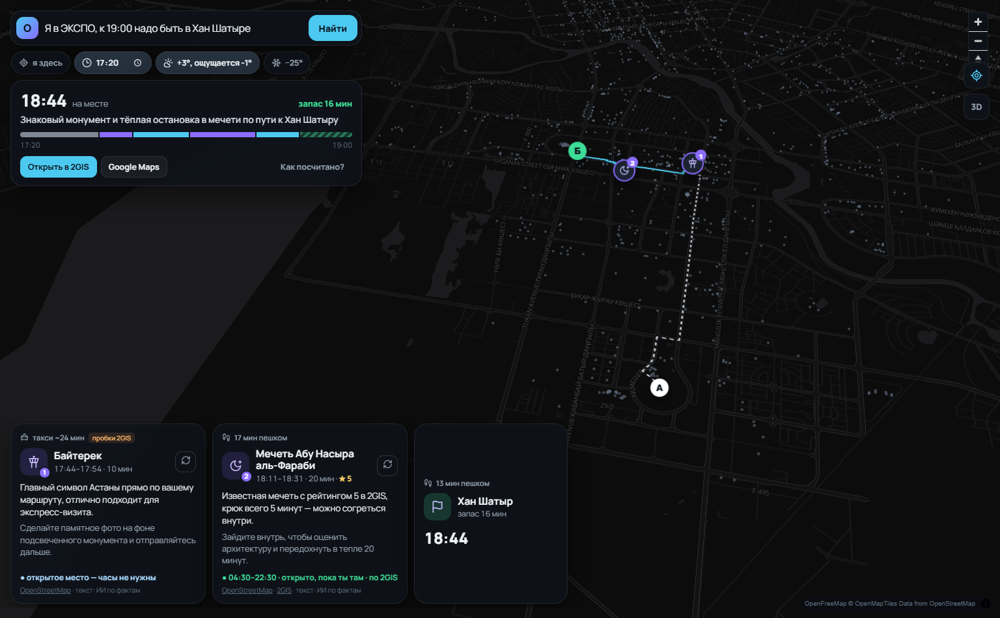
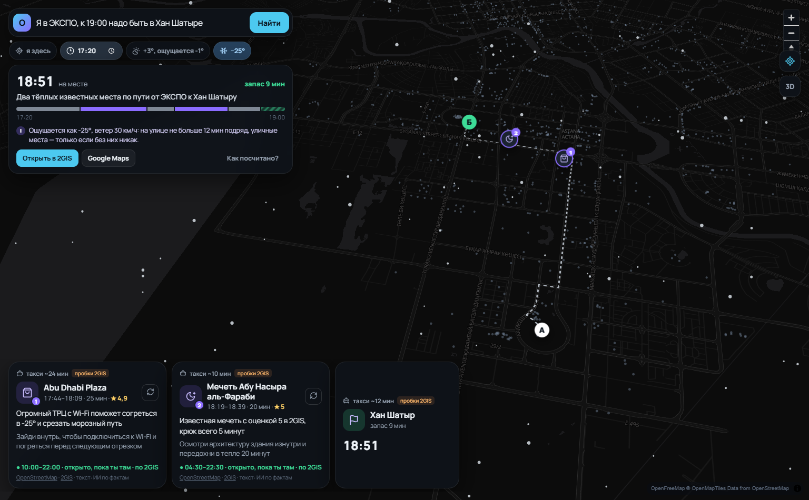
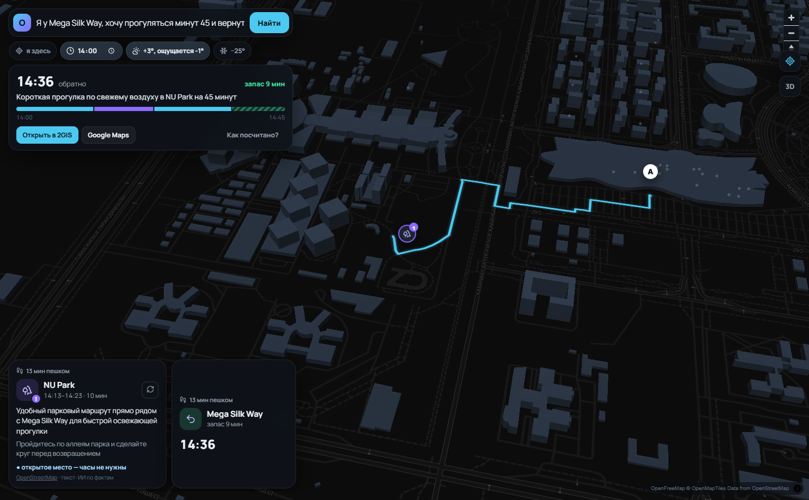
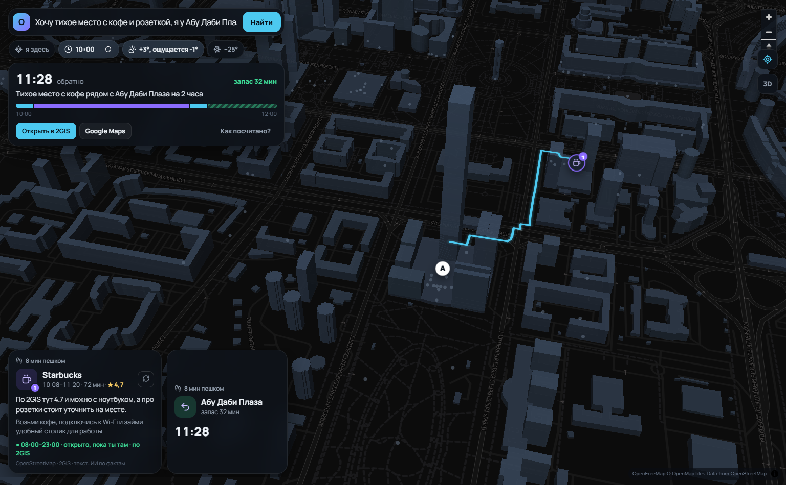
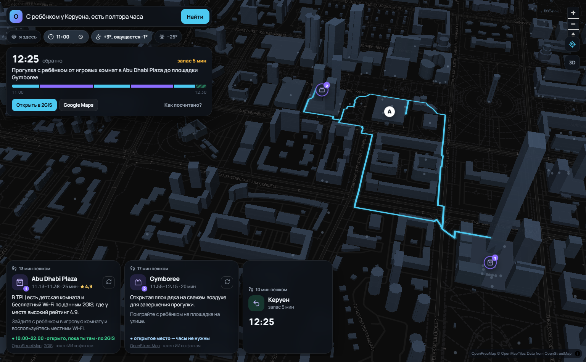
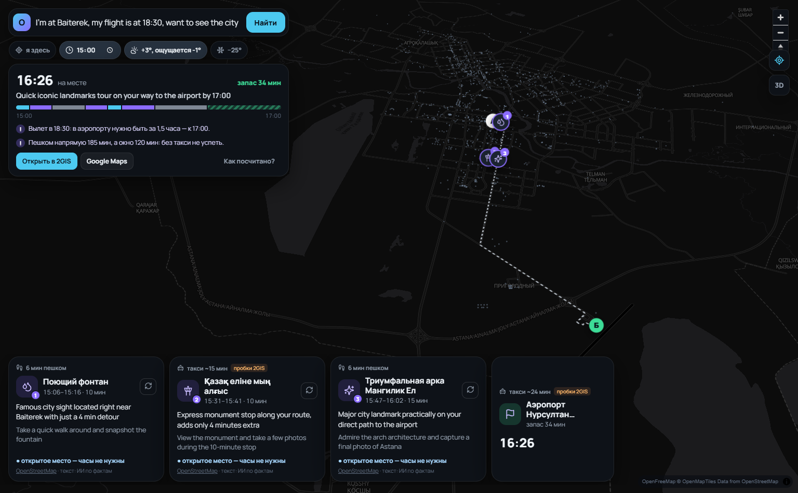
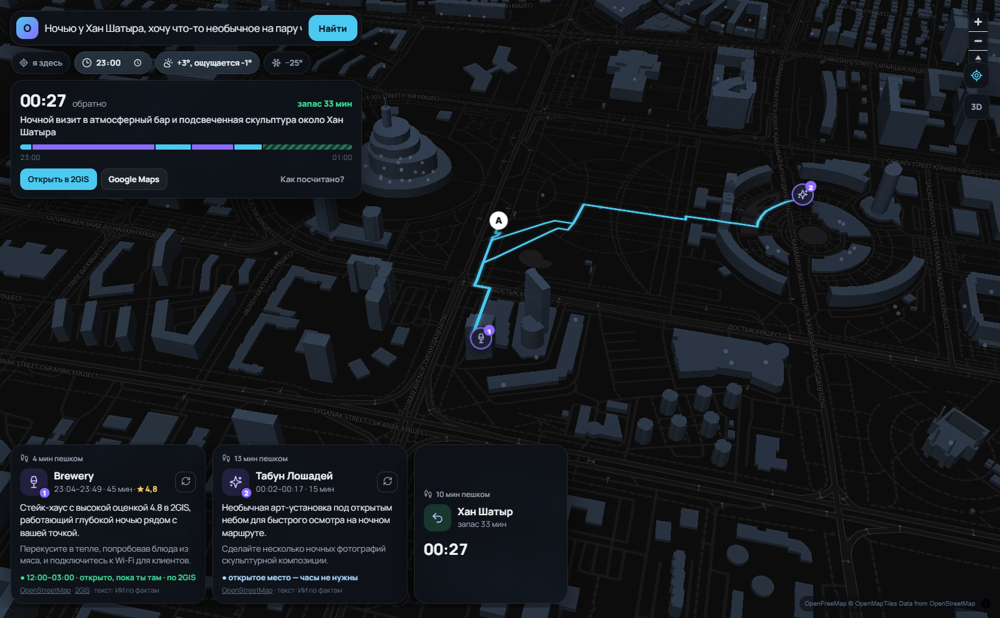

# Окно — тестовые сценарии, ограничения и этика

_Документ сгенерирован автоматически скриптом `scripts/make_scenarios_doc.py` 17.10.2026 03:12: каждый сценарий — реальный запрос к работающей системе, ответы ниже не редактировались._

**Итог автопроверок: 30 из 30 пройдено.** Стресс-тест: 100 запросов за 10 c: план 51, честный отказ 49, ошибок 0, нарушений 0

## 1. Что делает система

«Окно» — помощник по свободному времени в Астане. Человек пишет обычной фразой, где он, куда ему нужно и к скольки (или «есть час, потом обратно»). Система подбирает **1–3 реальных места по пути** так, чтобы человек точно успел: с реальным временем пешком, часами работы **на момент прихода**, погодой и ветром, оценкой пробок для такси.

### Как работает RAG (высокоуровнево)

1. **Понимание запроса (LLM).** Gemini превращает фразу в структуру: откуда, куда, к скольки, пожелания, язык. Если ИИ недоступен — работает запасной разбор правилами.
2. **Поиск по базе (Retrieval).** Алгоритм — не ИИ — отбирает кандидатов из базы мест OpenStreetMap и перебирает сотни вариантов маршрута. Жёсткие проверки: реальное время пешком по улицам (OSRM), часы работы на весь визит, мороз (не больше N минут на улице подряд), темнота (без парков и площадок), пожелания, запас до срока.
3. **Генерация (LLM).** Gemini получает **только факты** о выбранных местах и пишет короткие «почему» и «что делать» на языке пользователя. Ему запрещено придумывать рейтинги, меню, события и обещать то, чего нет в данных.
4. **Прозрачность.** В интерфейсе видно, что система поняла, какие шаги сделала и за сколько, какие данные использованы; у каждого места — пометка надёжности часов и ссылка на источник.

## 2. Данные

- **Источник:** OpenStreetMap через Overpass API. **Сбор автоматизирован:** `scripts/collect_osm.py`, GitHub Actions пересобирает базу каждый понедельник.
- **Объём:** 1289 мест Астаны; часы работы есть у 381 (29%).
- **Категории:** детская площадка — 336, кафе — 329, ресторан — 176, фастфуд — 125, бар — 106, торговый центр — 53, памятник — 39, парк — 35, кино — 10, библиотека — 10, театр — 9, достопримечательность — 9, музей — 8, развлечения — 8.
- **Ориентиры:** справочник из 18 известных мест (ЭКСПО, Байтерек, аэропорт, вокзалы…) для понимания фраз «я у …».
- **Уточнение по 2GIS (Places API):** для мест-кандидатов маршрута — свежие часы работы, рейтинг и отметки («Можно с ноутбуком», «Детский уголок», «Меню на английском»). Только для уже отобранных кандидатов (единицы запросов на маршрут), ответы кэшируются локально и не публикуются в репозитории; без ключа система работает на одном OSM. В интерфейсе помечено «2GIS».
- **Погода:** Open-Meteo (температура «ощущается как», ветер, закат) — живые данные, без ключа.
- **Маршруты:** OSRM (серверы FOSSGIS) — реальный путь по улицам пешком и на машине.
- **Чего в данных нет:** рейтингов, отзывов, очередей, временных закрытий, живых пробок, расписания транспорта, информации о розетках и тишине. Система об этом говорит, а не придумывает.

## 3. Тестовые сценарии

| № | Сценарий | Откуда в кейсе | Автопроверки | Время ответа |
|---|---|---|---|---|
| S1 | Деловой гость между встречами | свой (главный сценарий «Окна») | ✅ 5/5 | 6.8 с |
| S2 | То же в мороз −25° (симуляция) | учёт погоды | ✅ 4/4 | 6.8 с |
| S3 | «Я возле Mega Silk Way, хочу прогуляться 30–60 минут» | сценарий из кейса | ✅ 4/4 | 6.0 с |
| S4 | «Тихое место с кофе и розеткой» | сценарий из кейса | ✅ 4/4 | 6.7 с |
| S5 | «Еду с ребёнком» | сценарий из кейса | ✅ 4/4 | 6.4 с |
| S6 | «Я турист, 2 часа перед вылетом» | сценарий из кейса + мультиязычность | ✅ 5/5 | 7.1 с |
| S7 | «Необычная ночная активность» | сценарий из кейса | ✅ 3/3 | 7.2 с |
| S8 | Невыполнимое окно | сомнительный запрос | ✅ 1/1 | 4.0 с |

### S1. Деловой гость между встречами

- **Вход:** «Я в ЭКСПО, к 19:00 надо быть в Хан Шатыре» · время старта 17:20 · погода: реальная
- **Ожидаемый тип ответа:** Маршрут А→Б с 1–3 остановками, прибытие до 19:00 с запасом; если пешком не успеть — часть пути на такси с пометкой «оценка».
- **Как система поняла:** откуда — ЭКСПО, куда — Хан Шатыр, к — 19:00, окно — 100 мин, пожелания — нет, язык — ru
- **Ответ:** «Прогулка от Байтерека до мечети и финиш в Хан Шатыре к 18:44». Прибытие **18:44** (окно 17:20–19:00), запас 16 мин, на улице 30 мин (макс. подряд 17), пешком 2.2 км, такси: 1.

| Время | Место | Почему | Что делать | Часы работы |
|---|---|---|---|---|
| 17:44–17:54 | **Байтерек** (памятник) | Главный символ Астаны освещается в темноте, удобная точка остановки перед такси | Сделай пару снимков монумента с подсветкой и сразу вызывай такси | открытое место — часы не нужны · _открытое место_ |
| 18:11–18:31 | **Мечеть Абу Насыра аль-Фараби** (мечеть) | Знаковая мечеть с рейтингом 5 в 2GIS, крюк всего 5 минут | Зайди внутрь погреться, оценить архитектуру и сберечь запас времени | 04:30–22:30 · открыто, пока ты там · по 2GIS · _часы проверены (OSM)_ |

**Пояснения системы:** — Пешком напрямую 76 мин из 100: на остановки времени мало, часть пути — на такси. — Время на такси — по данным о пробках 2GIS (обычно в 17:00 в этот день недели) плюс подача машины ~6 мин. — Будет темно: парки и площадки не предлагаю, только освещённые и крытые места.

_Скриншот интерфейса на этом же запросе (отдельный прогон — формулировки ИИ могут немного отличаться)._

**Проверки:** ✅ Успевает к сроку (прибытие ≤ дедлайн) · ✅ 1–3 конкретных места · ✅ Каждое место открыто всё время визита · ✅ У каждого места есть пометка надёжности часов и ссылка на OSM · ✅ У каждого места есть «почему» и «что делать»

### S2. То же в мороз −25° (симуляция)

- **Вход:** «Я в ЭКСПО, к 19:00 надо быть в Хан Шатыре» · время старта 17:20 · **погода: симуляция −25°, ветер 30 км/ч**
- **Ожидаемый тип ответа:** Маршрут перестраивается через крытые места; уличных остановок нет; на улице не больше 12 мин подряд.
- **Как система поняла:** откуда — ЭКСПО, куда — Хан Шатыр, к — 19:00, окно — 100 мин, пожелания — нет, язык — ru
- **Ответ:** «Две тёплые остановки в помещении по пути от ЭКСПО к Хан Шатыру». Прибытие **18:51** (окно 17:20–19:00), запас 9 мин, на улице 0 мин (макс. подряд 0), пешком 0.0 км, такси: 3.

| Время | Место | Почему | Что делать | Часы работы |
|---|---|---|---|---|
| 17:44–18:09 | **Abu Dhabi Plaza** (торговый центр) | Огромный ТРЦ на маршруте с рейтингом 4,9 в 2GIS — идеальное место согреться в -25°. | Погрейся в тепле, при желании подключайся к бесплатному Wi-Fi и иди дальше. | 10:00–22:00 · открыто, пока ты там · по 2GIS · _часы проверены (OSM)_ |
| 18:19–18:39 | **Мечеть Абу Насыра аль-Фараби** (мечеть) | Известная мечеть с оценкой 5 в 2GIS, крюк всего 5 минут от прямого пути. | Зайди внутрь на 20 минут, чтобы посмотреть архитектуру и укрыться от ветра 30 км/ч. | 04:30–22:30 · открыто, пока ты там · по 2GIS · _часы проверены (OSM)_ |

**Пояснения системы:** — Пешком напрямую 76 мин из 100: на остановки времени мало, часть пути — на такси. — Ощущается как -25°, ветер 30 км/ч: на улице не больше 12 мин подряд, уличные места — только если без них никак. — Время на такси — по данным о пробках 2GIS (обычно в 17:00 в этот день недели) плюс подача машины ~6 мин.

_Скриншот интерфейса на этом же запросе (отдельный прогон — формулировки ИИ могут немного отличаться)._

**Проверки:** ✅ Успевает к сроку (прибытие ≤ дедлайн) · ✅ В мороз нет уличных остановок · ✅ В мороз на улице не больше 12 мин подряд · ✅ Каждое место открыто всё время визита

### S3. «Я возле Mega Silk Way, хочу прогуляться 30–60 минут»

- **Вход:** «Я у Mega Silk Way, хочу прогуляться минут 45 и вернуться» · время старта 14:00 · погода: реальная
- **Ожидаемый тип ответа:** Пешая прогулка по кругу с 1–2 точками, возврат к Mega за 45 минут, без такси.
- **Как система поняла:** откуда — Mega Silk Way, куда — обратно, к — —, окно — 45 мин, пожелания — walk, язык — ru
- **Ответ:** «Короткая прогулка по NU Park на 45 минут с возвращением к Mega Silk Way». Прибытие **14:36** (окно 14:00–14:45), запас 9 мин, на улице 26 мин (макс. подряд 13), пешком 1.9 км, такси: 0.

| Время | Место | Почему | Что делать | Часы работы |
|---|---|---|---|---|
| 14:13–14:23 | **NU Park** (парк) | Ближайший парк прямо напротив ТРЦ для быстрой освежающей прогулки | Пройдись по аллеям 10 минут и подыши свежим воздухом | открытое место — часы не нужны · _открытое место_ |

_Скриншот интерфейса на этом же запросе (отдельный прогон — формулировки ИИ могут немного отличаться)._

**Проверки:** ✅ Успевает к сроку (прибытие ≤ дедлайн) · ✅ Маршрут возвращает в точку старта · ✅ Прогулка — без такси · ✅ Каждое место открыто всё время визита

### S4. «Тихое место с кофе и розеткой»

- **Вход:** «Хочу тихое место с кофе и розеткой, я у Абу Даби Плаза, часа два» · время старта 10:00 · погода: реальная
- **Ожидаемый тип ответа:** Одно кафе надолго; честно: данных о розетках нет — уточнить на месте.
- **Как система поняла:** откуда — Абу Даби Плаза, куда — обратно, к — —, окно — 120 мин, пожелания — coffee, work, язык — ru
- **Ответ:** «Тихое место с кофе рядом с Абу Даби Плаза на пару часов». Прибытие **11:28** (окно 10:00–12:00), запас 32 мин, на улице 16 мин (макс. подряд 8), пешком 1.2 км, такси: 0.

| Время | Место | Почему | Что делать | Часы работы |
|---|---|---|---|---|
| 10:08–11:20 | **Starbucks** (кафе) | По 2GIS тут 4.7 и отметка «можно с ноутбуком», а про розетки стоит уточнить на месте | Возьми кофе, подключайся к Wi-Fi и займи удобный столик для работы | 08:00–23:00 · открыто, пока ты там · по 2GIS · _часы проверены (OSM)_ |

_Скриншот интерфейса на этом же запросе (отдельный прогон — формулировки ИИ могут немного отличаться)._

**Проверки:** ✅ Успевает к сроку (прибытие ≤ дедлайн) · ✅ Одно место надолго (для работы) · ✅ Каждое место открыто всё время визита · ✅ Честно говорит, что про розетки данных нет

### S5. «Еду с ребёнком»

- **Вход:** «С ребёнком у Керуена, есть полтора часа» · время старта 11:00 · погода: реальная
- **Ожидаемый тип ответа:** Места для ребёнка (ТРЦ, площадки, развлечения) в пешей доступности, возврат к Керуену.
- **Как система поняла:** откуда — Керуен, куда — обратно, к — —, окно — 90 мин, пожелания — kids, язык — ru
- **Ответ:** «Развлечения для ребёнка в Abu Dhabi Plaza и прогулка на площадке Gymboree». Прибытие **12:25** (окно 11:00–12:30), запас 5 мин, на улице 40 мин (макс. подряд 17), пешком 3.0 км, такси: 0.

| Время | Место | Почему | Что делать | Часы работы |
|---|---|---|---|---|
| 11:13–11:38 | **Abu Dhabi Plaza** (торговый центр) | По данным 2GIS тут высокий рейтинг 4.9 и есть детская игровая комната. | Зайдите в игровой уголок и воспользуйтесь бесплатным Wi-Fi. | 10:00–22:00 · открыто, пока ты там · по 2GIS · _часы проверены (OSM)_ |
| 11:55–12:15 | **Gymboree** (детская площадка) | Открытая площадка рядом, чтобы ребенок побегал на свежем воздухе. | Поиграйте на свежем воздухе перед возвращением. | открытое место — часы не нужны · _открытое место_ |

_Скриншот интерфейса на этом же запросе (отдельный прогон — формулировки ИИ могут немного отличаться)._

**Проверки:** ✅ Успевает к сроку (прибытие ≤ дедлайн) · ✅ Есть место для ребёнка · ✅ Маршрут возвращает в точку старта · ✅ Каждое место открыто всё время визита

### S6. «Я турист, 2 часа перед вылетом»

- **Вход:** «I'm at Baiterek, my flight is at 18:30, want to see the city» · время старта 15:00 · погода: реальная
- **Ожидаемый тип ответа:** Известные места города, финиш в аэропорту к 17:00 (за 1,5 ч до вылета); ответ на английском.
- **Как система поняла:** откуда — Baiterek, куда — аэропорт, к — 18:30, окно — 120 мин, пожелания — sights, язык — en
- **Ответ:** «Quick sightseeing route to the airport with three iconic outdoor stops». Прибытие **16:26** (окно 15:00–17:00), запас 34 мин, на улице 12 мин (макс. подряд 6), пешком 0.9 км, такси: 2.

| Время | Место | Почему | Что делать | Часы работы |
|---|---|---|---|---|
| 15:06–15:16 | **Поющий фонтан** (фонтан) | A quick look at a popular city spot with only a 4-minute detour. | Walk around the fountain and take a couple of photos. | открытое место — часы не нужны · _открытое место_ |
| 15:31–15:41 | **Қазақ еліне мың алғыс** (памятник) | An outdoor monument right along your route with a 4-minute detour. | Stop by to see the monument and read the inscription. | открытое место — часы не нужны · _открытое место_ |
| 15:47–16:02 | **Триумфальная арка Мангилик Ел** (достопримечательность) | A famous landmark from Wikipedia, adding just a 1-minute detour. | Examine the arch from below before getting into the taxi to the airport. | открытое место — часы не нужны · _открытое место_ |

**Пояснения системы:** — Вылет в 18:30: в аэропорту нужно быть за 1,5 часа — к 17:00. — Пешком напрямую 185 мин, а окно 120 мин: без такси не успеть. — Время на такси — по данным о пробках 2GIS (обычно в 15:00 в этот день недели) плюс подача машины ~6 мин.

_Скриншот интерфейса на этом же запросе (отдельный прогон — формулировки ИИ могут немного отличаться)._

**Проверки:** ✅ Успевает к сроку (прибытие ≤ дедлайн) · ✅ Учитывает регистрацию: в аэропорту за 1,5 ч до вылета · ✅ Ответ на языке запроса (английский) · ✅ Каждое место открыто всё время визита · ✅ У каждого места есть пометка надёжности часов и ссылка на OSM

### S7. «Необычная ночная активность»

- **Вход:** «Ночью у Хан Шатыра, хочу что-то необычное на пару часов» · время старта 23:00 · погода: реальная
- **Ожидаемый тип ответа:** Места, открытые ночью (часы проверены на весь визит); без парков и площадок в темноте.
- **Как система поняла:** откуда — Хан Шатыр, куда — обратно, к — —, окно — 120 мин, пожелания — night, sights, язык — ru
- **Ответ:** «Ночной маршрут с необычными арт-объектами и баром Brewery с высоким рейтингом 4.8». Прибытие **00:52** (окно 23:00–01:00), запас 8 мин, на улице 42 мин (макс. подряд 13), пешком 3.2 км, такси: 0.

| Время | Место | Почему | Что делать | Часы работы |
|---|---|---|---|---|
| 23:10–23:20 | **Махтумкули Фраги** (памятник) | Необычный монумент по пути для быстрого ночного осмотра. | Рассмотрите памятник поэту и сделайте пару снимков при подсветке. | открытое место — часы не нужны · _открытое место_ |
| 23:29–00:14 | **Brewery** (бар) | Теплое место с рейтингом 4.8 в 2GIS, где есть Wi-Fi для клиентов. | Закажите стейк и согрейтесь в атмосферном заведении перед продолжением прогулки. | 12:00–03:00 · открыто, пока ты там · по 2GIS · _часы проверены (OSM)_ |
| 00:27–00:42 | **Табун Лошадей** (достопримечательность) | Шикарная арт-инсталляция неподалеку от Хан Шатыра для финала ночного маршрута. | Оцените масштаб скульптурной композиции перед прибытием в точку назначения. | открытое место — часы не нужны · _открытое место_ |

**Пояснения системы:** — Будет темно: парки и площадки не предлагаю, только освещённые и крытые места.

_Скриншот интерфейса на этом же запросе (отдельный прогон — формулировки ИИ могут немного отличаться)._

**Проверки:** ✅ Успевает к сроку (прибытие ≤ дедлайн) · ✅ Каждое место открыто всё время визита · ✅ Ночью нет парков и площадок

### S8. Невыполнимое окно

- **Вход:** «Я в ЭКСПО, через 30 минут надо быть на вокзале Астана-1» · время старта 12:00 · погода: реальная
- **Ожидаемый тип ответа:** Не выдумывать маршрут: честно сказать, что пешком не успеть, и предложить такси.
- **Как система поняла:** откуда — ЭКСПО, куда — Вокзал Астана-1, к — —, окно — 30 мин, пожелания — нет, язык — ru
- **Ответ:** Не успеть даже на такси: ~46 мин (оценка), а окно 30 мин. Стоит предупредить, что опоздаешь.

**Проверки:** ✅ Честный отказ с практическим советом

### S9. Кнопка «другое место»

- **Действие:** в сценарии S1 заменить первую остановку «Байтерек», остальные оставить.
- **Результат:** Mega Silk Way, Мечеть Абу Насыра аль-Фараби.
- **Проверки:** ✅ замена другая, остальные остановки сохранены, по-прежнему успевает.

## 4. Стресс-тест

`scripts/stress.py` генерирует случайные запросы (случайные ориентиры, время суток, окно 20–180 мин, пожелания, мороз) и проверяет два инварианта: **ни одного опоздания** и **ни одного места, закрытого во время визита**.

Результат на 100 запросах: `100 запросов за 10 c: план 51, честный отказ 49, ошибок 0, нарушений 0`. «Честный отказ» — когда маршрут с остановками невозможен (например, 200 минут пешком при окне 30): система не выдумывает, а объясняет и советует (такси / просто идти).

## 5. Ограничения

| Ограничение | Как система с этим работает |
|---|---|
| Часы работы есть только у 29% мест | Для остальных — типичные часы категории с пометкой «оценка»; уличные места помечены «часы не нужны». |
| Нет рейтингов и отзывов | Не придумываем. Как сигнал известности используем наличие статьи в Википедии/Wikidata и полноту описания в OSM. |
| Пробки — не живые | Время такси = маршрут по дорогам × коэффициент часа пик (утро ×1,7, вечер ×1,9) + подача 6 мин; всегда с пометкой «оценка». |
| Нет расписания автобусов и LRT | Общественный транспорт не планируем — честнее, чем обещать время прихода автобуса. |
| Временные закрытия, ремонты, события | В OSM их нет. Ссылка на источник у каждого места, чтобы проверить; в плане развития — интеграция с афишами. |
| Зависимость от бесплатных сервисов маршрутов | Кэш маршрутов на диске; если сервис не отвечает — оценка по прямой ×1,35 с пометкой, и минута паузы до следующей попытки. |
| ИИ может ответить медленно или не ответить | Жёсткий лимит ожидания (8 и 11 с), запасная модель, затем шаблонный текст — демо не зависает. |
| Аттракционы внутри ТРЦ размечены в OSM как уличные | Автоматически переносим их «внутрь ТРЦ» с часами ТРЦ. |

## 6. Сомнительные и неполные данные

- **Нет часов работы** → показываем типичные для категории и пишем «обычно до … · оценка, данных нет»; в рейтинге такие места ниже проверенных.
- **Место помечено в OSM как закрытое** → исключается.
- **Место закроется во время визита** → исключается (проверяем не «открыто сейчас», а «открыто с прихода до ухода»).
- **Человек просит то, чего нет в данных** (розетки, тишина, Wi-Fi, вид) → ИИ обязан сказать, что данных нет, и предложить уточнить на месте.
- **Невозможное окно** → честный отказ с практическим советом вместо выдуманного маршрута.
- **Источник каждой рекомендации** помечен: место — из базы OSM (со ссылкой), текст — сгенерирован ИИ по фактам, часы — проверены или оценка.

## 7. Этика и приватность

- **Точная локация не хранится.** Точка на карте округляется до ~150 м ещё в браузере; на сервере — только округлённая, запросы и координаты не пишутся в логи и базы.
- **Минимум данных:** нет регистрации, аккаунтов, истории запросов.
- **Прозрачность:** блок «Какие данные использованы» в каждом ответе; видно, что понял ИИ и что сделал алгоритм.
- **Места выбирает алгоритм, а не ИИ** — ИИ не может «придумать» место, которого нет в базе.
- **Безопасность:** в мороз ограничиваем время на улице подряд; в темноте не ведём в парки и на площадки; с ребёнком — только подходящие места.
- **Соответствие закону РК «Об искусственном интеллекте» (действует с 18.01.2026):** не собираем персональные данные, явно помечаем сгенерированный контент.
